# Osprey

<div align="center">
  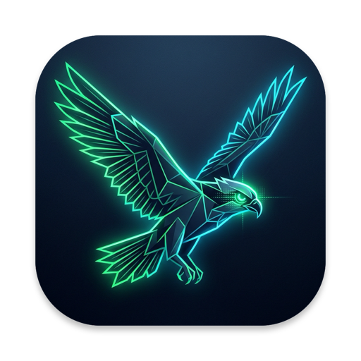
  <h3>Osprey – Hardware Telemetry, System Monitor & S.M.A.R.T. Engine</h3>
  <p>Unified macOS &amp; Linux hardware monitor: deep NVMe/ATA storage S.M.A.R.T. diagnostics, battery degradation telemetry, a native floating desktop HUD and menu bar extra on macOS, and a full-featured terminal CLI on both platforms.</p>
</div>

[](https://github.com/kraloveckey/osprey/actions/workflows/ci.yml)
[](LICENSE)
[](#platform-support)
[](https://www.rust-lang.org/)

---

## Visual Interface Tour

### 1. Multi-Section Desktop Floating HUD
Features live vitals, CPU core loads, memory breakdown with Swap tracking, SMART status, battery condition, network rates, and top 5 processes:
<p align="center">
  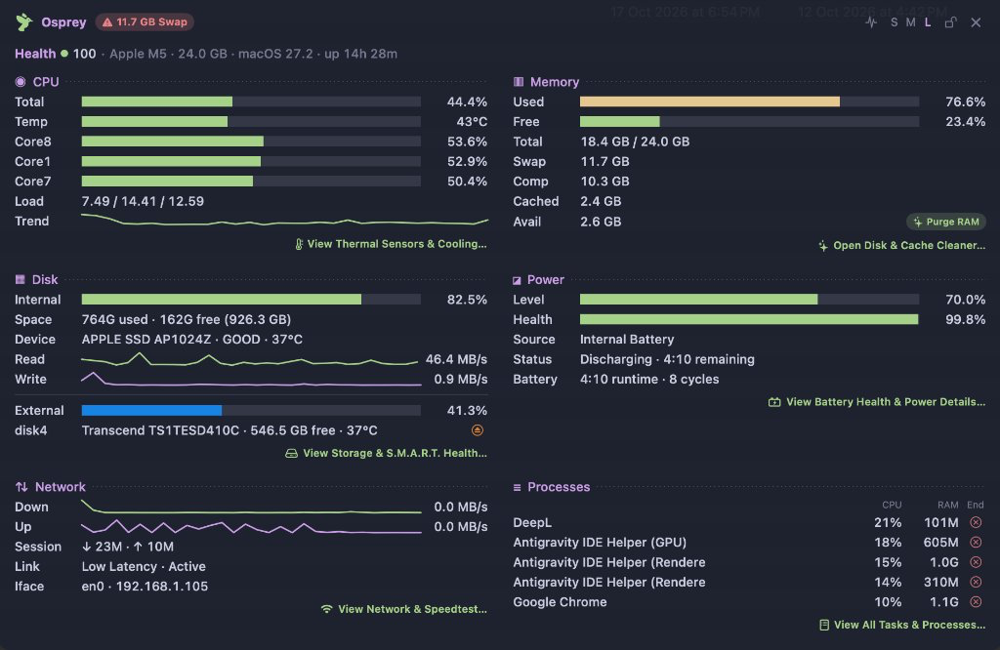
</p>

### 2. Storage S.M.A.R.T. Inspector
Deep NVMe & ATA health diagnostics, raw hexadecimal registers, APFS container mapping, and controller capabilities:
<p align="center">
  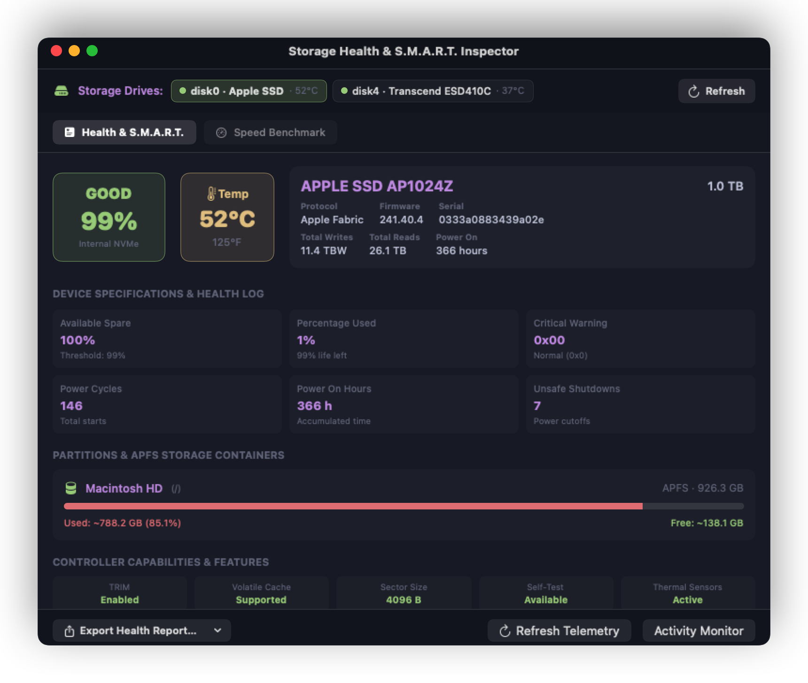
</p>

### 3. Battery & Real-Time Power Flow Inspector
Net instant power draw in Watts, pack voltage (mV), amperage load (mA), lifetime cycle count, health degradation, OEM adapter & cable authentication, Low Power Mode state, and text/JSON diagnostic report export:
<p align="center">
  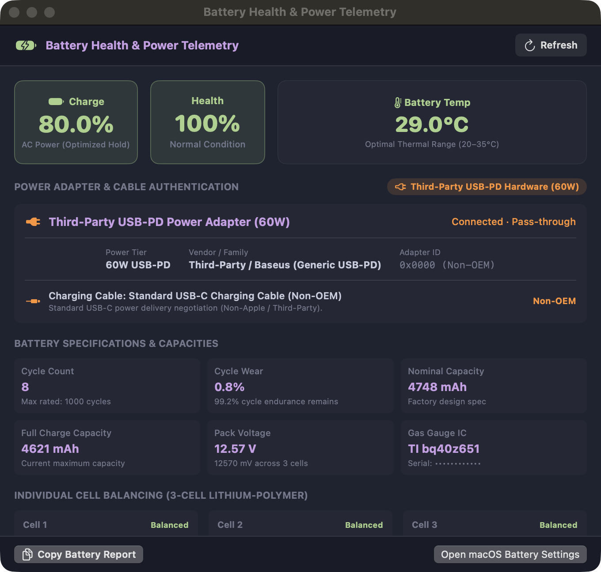
</p>

### 4. Hardware Thermal Sensors & Cooling Architecture
Per-core silicon junction thermistors (P-cores, E-cores, GPU cluster, Apple Neural Engine, SoC die, SSD NAND, battery), Left/Right Turbofans tachometers (RPM and % load), and macOS Dynamic Thermal Policy:
<p align="center">
  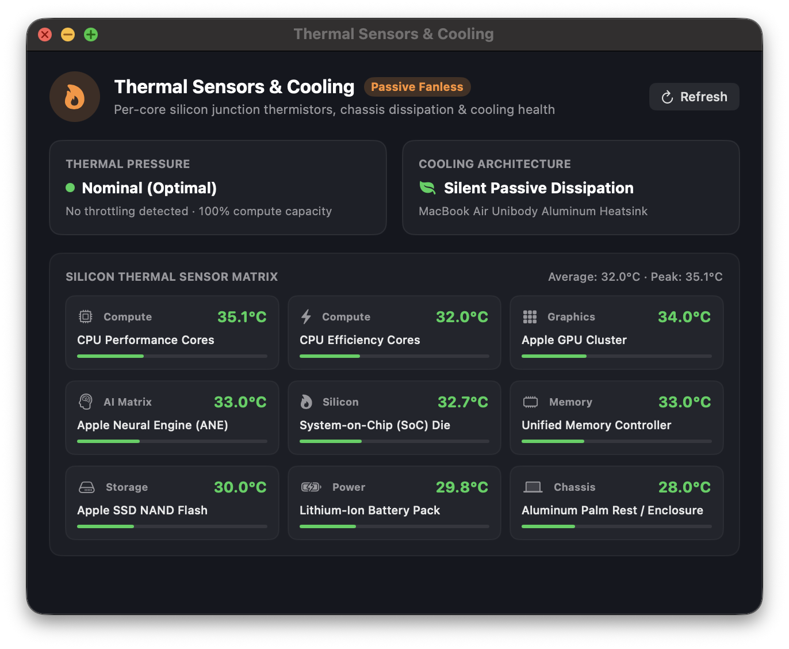
</p>

### 5. Network Throughput & Active Sockets Inspector
Wi-Fi telemetry (BSSID, RSSI, channel, PHY mode), real-time download/upload benchmarks, and live process socket monitor with search, filters (All, Established, Listening), and 1-click process termination:
<p align="center">
  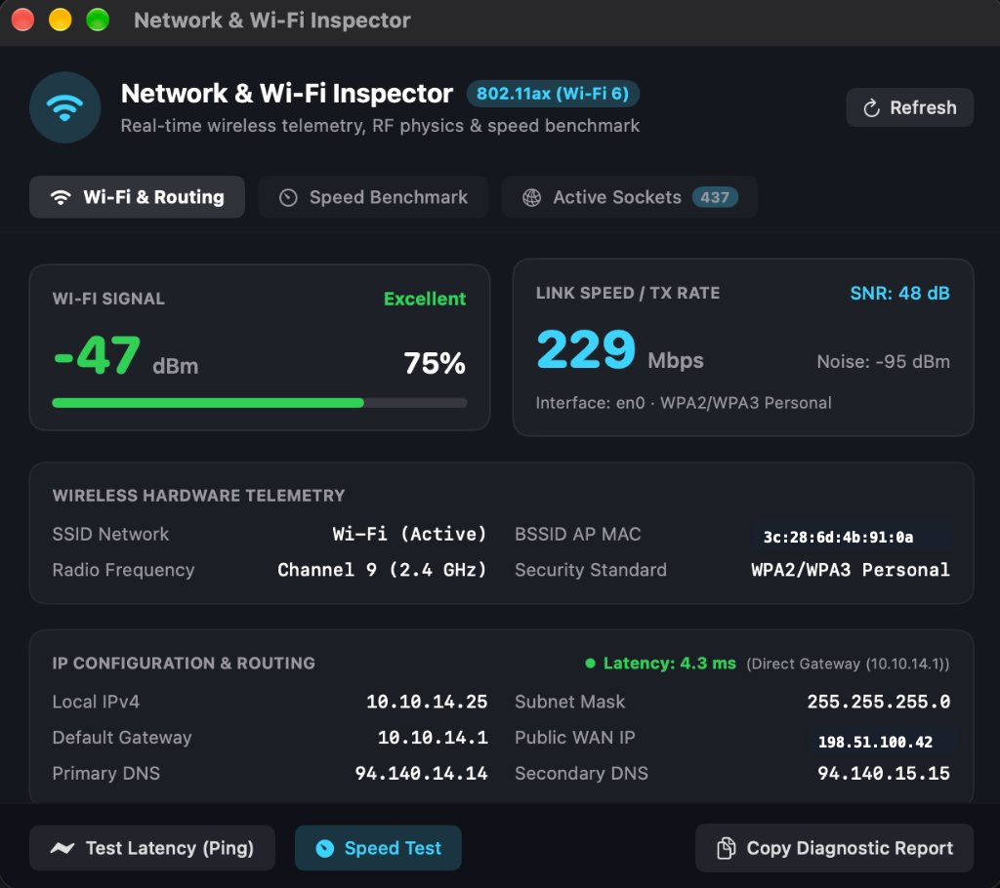
</p>

### 6. Process Inspector & Task Manager
Live per-app CPU load, RSS memory footprint, thread counts, quick search filtering, and 1-click process termination:
<p align="center">
  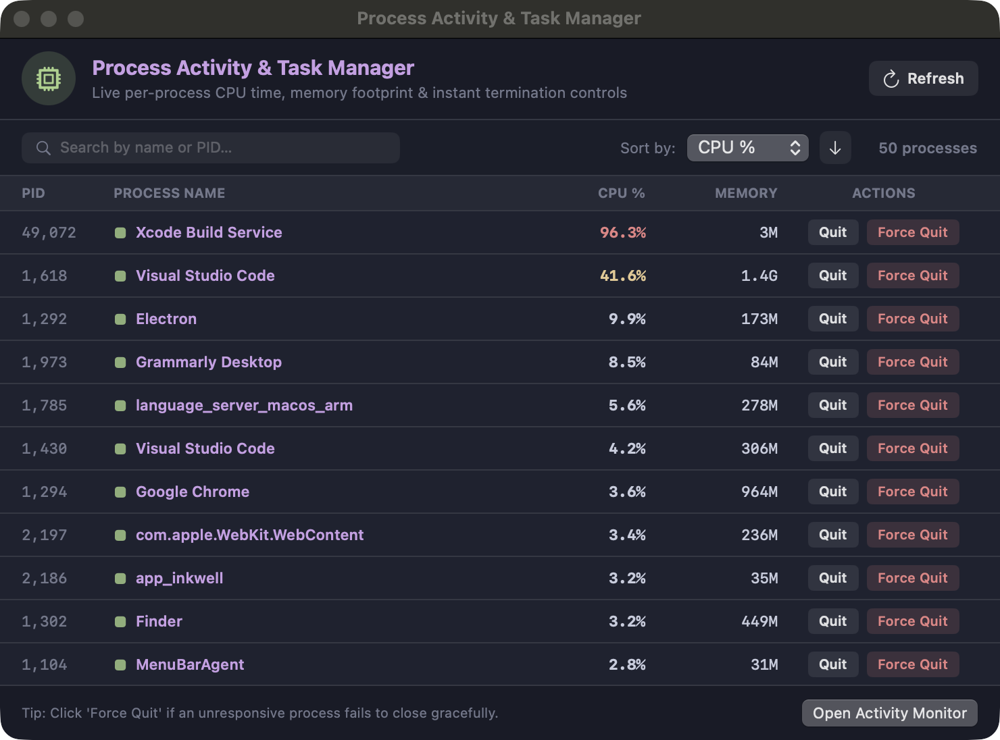
</p>

### 7. Storage Junk Cleaner & Maintenance
Fast reclamation of Xcode build caches, simulator runtimes, system log files, user caches, downloads, and trash:
<p align="center">
  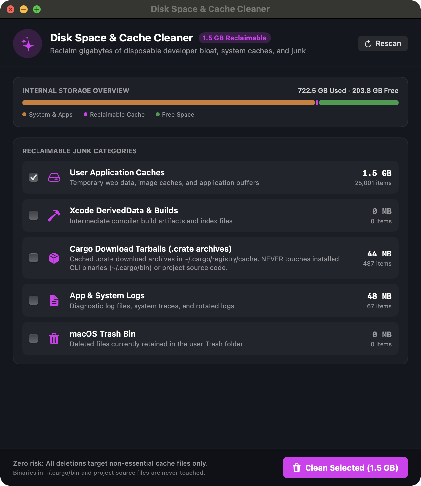
</p>

### 8. Storage Speed Benchmark
Sequential read/write throughput and random 4K IOPS storage performance benchmarking:
<p align="center">
  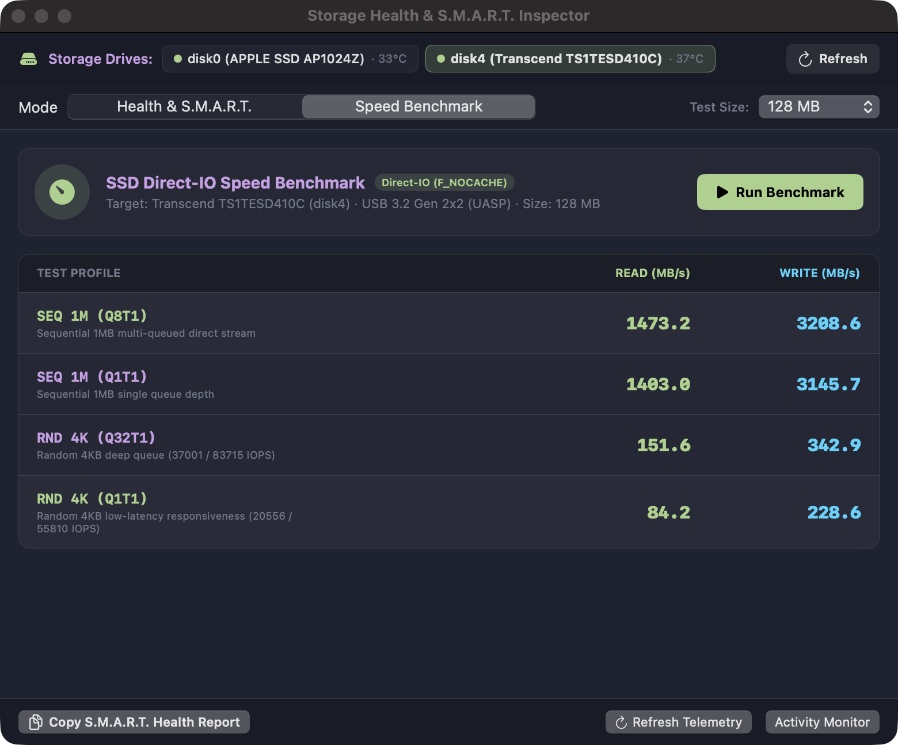
</p>

### 9. Alert Channels & Real-time Webhooks
Configurable thermal thresholds, SSD swap wear warnings, and real-time webhook dispatchers (Telegram, Discord, Slack, Email):
<p align="center">
  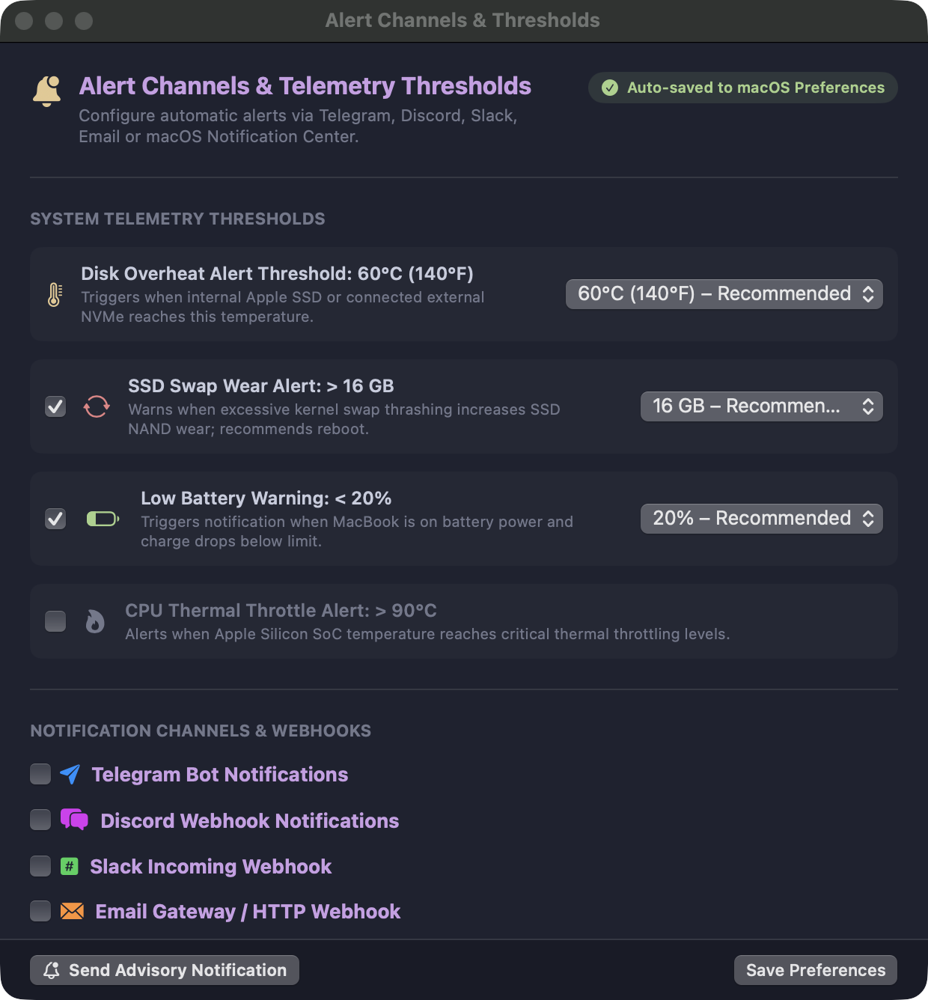
</p>

### 10. Menu Bar Extra & Quick Actions
Compact menu bar dropdown with live metrics, reboot advisory dialog, and inspector window shortcuts:
<p align="center">
  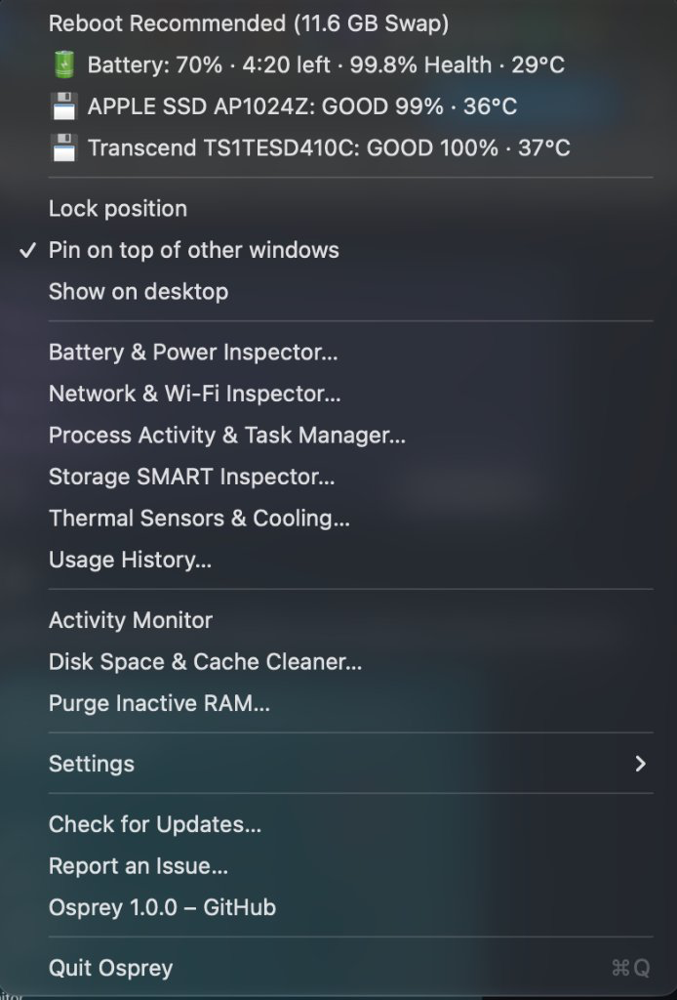
</p>

### 11. In-App Software Update Service
Zero-dependency GitHub release version checking with semantic comparison, release notes rendering, and direct installation:
<p align="center">
  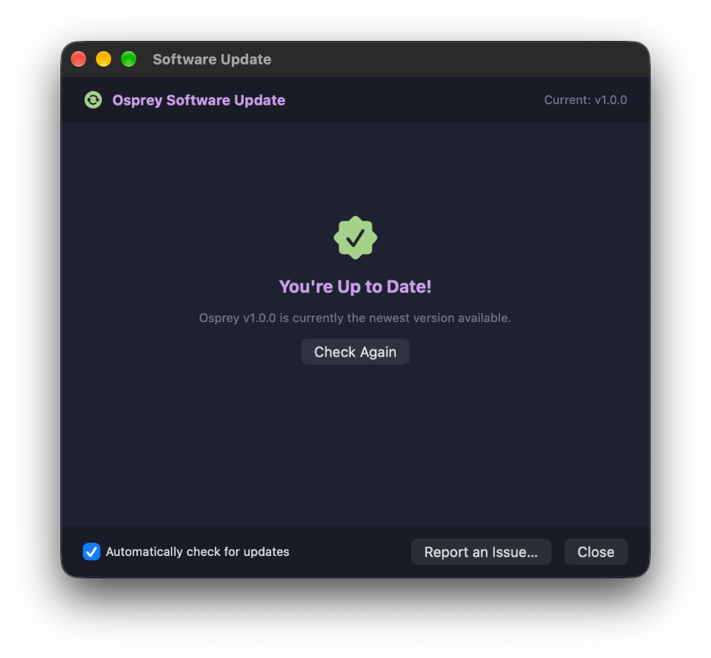
</p>

---

## Key Capabilities

- **Unified System Telemetry & Composite Health Score**:
  - Live composite health score (0-100) combining CPU thermal stress, memory saturation, storage fill, and battery degradation.
  - Full-width system vitals header (SoC chip brand, total physical RAM, OS version, kernel uptime).
- **CPU & Core Load Telemetry**:
  - Global CPU utilization, load averages (1m / 5m / 15m), CPU temperature (AppleSMC on macOS – app and CLI, hwmon on Linux), top-3 busiest cores breakdown, and live historical sparkline trend.
- **Memory Pressure & Architecture**:
  - Used, free, cached, and available memory with clean byte formatting and visual load bars.
  - One-click memory purge to flush inactive file system memory buffers.
- **Deep Storage S.M.A.R.T. Engine**:
  - Root volume filesystem usage and live disk I/O read/write transfer rates.
  - Direct Apple Fabric NVMe Log Page 0x02 decoding: percentage used / wear level, spare capacity %, host bytes read/written (TBW), composite temperature, power-on hours, and unsafe shutdowns.
  - External USB, Thunderbolt, and SATA physical drive auto-discovery and sequential/random 4K benchmark engine.
- **Power & Real-Time Energy Flow**:
  - Charge level %, health percentage, state (Charging, Discharging, AC Idle), lifetime cycle count, pack voltage (mV), and battery temperature.
  - Real-time instant wattage calculation: (Voltage * Amperage) / 1,000,000 for precise live energy draw in Watts.
  - Low Power Mode detection and OEM Apple vs Third-Party charger/cable authentication.
  - Text and JSON battery report exporter.
- **Hardware Thermal Matrix & Fan Tachometers**:
  - Silicon junction thermistors (P-cores, E-cores, GPU, Neural Engine, SoC, NAND flash, battery, chassis).
  - Left & Right Turbofans tachometers (RPM, % load, 1200-5800 RPM scale) on active cooling Macs, and silent passive dissipation mode on MacBook Air.
- **Network I/O & Active Sockets Inspector**:
  - Active primary network interface detection, local IP address, live download & upload transfer rates.
  - Active network connections and listening sockets monitor with search, state filters, and 1-click process termination.
- **Usage History & Telemetry Export**:
  - Retrospective 1h/6h/24h usage scrubber for CPU, memory, and top processes.
  - Full CSV and JSON history export with custom timeframes.
- **System Degradation & Reboot Advisory Engine**:
  - Real-time detection of virtual memory swap accumulation (e.g., > 3 GB / > 8 GB paged to SSD).
  - Continuous kernel uptime tracking (> 14 / > 28 days) and memory compressor load evaluation.
  - Headroom monitoring on APFS boot container (< 18% / < 12% free space).
  - Clear actionable guidance: alerts when a quick restart will flush swap files, restore unified memory bandwidth, and reduce SSD write fatigue.
  - Native macOS Notification Center alerts via `osprey notify` or HUD 1-click trigger.
- **Native Desktop Floating HUD & App Bundle**:
  - Native borderless, translucent Cocoa window with Apple Design aesthetics living right on the desktop.
  - Zero browser chrome, zero URL bars, zero tab clutter.
  - Sizing presets (`S`, `M`, `L`, `XL`) to switch between compact vitals and comprehensive multi-section diagnostics.
  - Resizing: the right edge widens the columns; the bottom edge or the corner zooms the whole widget proportionally (70–200 %, also via `−`/`+`). The height always fits the content exactly – nothing is clipped, no empty gaps. Double-click the bottom edge or the corner to reset to 100 %.
  - Instant Activity Monitor launch on clicking CPU, Memory, or Disk section headers.
  - Standalone macOS `.app` bundle builder (`make app` creates `dist/Osprey.app` with Retina `AppIcon.icns`).
- **Zero Runtime Dependencies**:
  - Single self-contained Rust CLI binary (~2.5 MB) with the web dashboard assets embedded.
  - Optional: `smartctl` (smartmontools) for S.M.A.R.T. data on Linux and external drives; reading S.M.A.R.T. on Linux usually needs `sudo`.


---

## Architecture

For detailed cross-platform design, Linux kernel abstractions, and macOS Cocoa windowing, see [Architecture & System Design](docs/architecture.md).

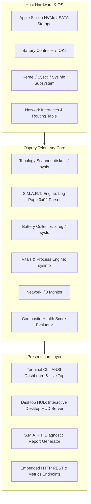

---

## Installation & Quick Start

### Option 1: Direct Download (Pre-built GitHub Releases) – Recommended

Pre-compiled standalone packages are available for macOS and Linux on [GitHub Releases](https://github.com/kraloveckey/osprey/releases/latest).

#### Which package should I download?

| Release File | Operating System | Architecture | What is inside & How to use |
| :--- | :--- | :--- | :--- |
| **`Osprey-macOS-arm64.zip`** | **macOS 14+** | **Apple Silicon (M1 / M2 / M3 / M4 / M5)** | **Full native macOS desktop app (`Osprey.app`)**.<br>Includes the floating desktop HUD widget, menu bar status item, visual inspectors (S.M.A.R.T., Battery, Thermals, Network, Processes, Disk Cleaner, Storage Benchmark), and bundled CLI tool.<br>👉 **Installation:** Download, double-click to unzip, and drag `Osprey.app` into your `/Applications` folder. |
| **`osprey-macos-arm64.tar.gz`** | **macOS** | **Apple Silicon (aarch64)** | **Standalone terminal CLI binary (`osprey`)**.<br>Designed for terminal telemetry, background scripts, cron jobs, and interactive `osprey top` monitoring without launching the GUI desktop app.<br>👉 **Installation:** `tar -xzvf osprey-macos-arm64.tar.gz && sudo mv osprey /usr/local/bin/` |
| **`osprey-macos-x86_64.tar.gz`** | **macOS** | **Intel (x86_64)** | **Standalone terminal CLI binary (`osprey`)**.<br>For older Intel-based Mac machines.<br>👉 **Installation:** `tar -xzvf osprey-macos-x86_64.tar.gz && sudo mv osprey /usr/local/bin/` |
| **`osprey-linux-x86_64.tar.gz`** | **Linux** | **x86_64 (GNU/Linux)** | **Standalone terminal CLI binary (`osprey`)**.<br>For Linux distributions (Ubuntu, Debian, Fedora, Arch, CentOS, openSUSE, etc.). Provides NVMe/ATA S.M.A.R.T. health (via `smartctl`), CPU temperature from hwmon, battery health, and system telemetry in the terminal.<br>👉 **Installation:** `tar -xzvf osprey-linux-x86_64.tar.gz && sudo mv osprey /usr/local/bin/` |
| **`osprey-linux-arm64.tar.gz`** | **Linux** | **arm64 / aarch64 (GNU/Linux)** | Same CLI for ARM machines (Raspberry Pi 4/5 with 64-bit OS, Ampere/Graviton servers, Linux VMs on Apple Silicon).<br>👉 **Installation:** `tar -xzvf osprey-linux-arm64.tar.gz && sudo mv osprey /usr/local/bin/` |

#### One-Liner Quick CLI Installation:

**macOS (Apple Silicon):**
```bash
curl -sSL https://github.com/kraloveckey/osprey/releases/latest/download/osprey-macos-arm64.tar.gz | tar -xz && sudo mv osprey /usr/local/bin/
osprey scan
```

**Linux (x86_64 or arm64 – picked automatically):**
```bash
ARCH=$(uname -m | sed 's/aarch64/arm64/')
curl -sSL "https://github.com/kraloveckey/osprey/releases/latest/download/osprey-linux-${ARCH}.tar.gz" | tar -xz && sudo mv osprey /usr/local/bin/
osprey scan
```

### Option 2: Homebrew (macOS, CLI also on Linux)

Install the native macOS desktop app and CLI directly via Homebrew (no extra tap repositories required):

```bash
# Install native macOS app bundle (.app in /Applications) and CLI in PATH:
brew install --cask https://raw.githubusercontent.com/kraloveckey/osprey/main/Casks/osprey.rb

# Or install standalone terminal CLI tool:
brew install https://raw.githubusercontent.com/kraloveckey/osprey/main/Formula/osprey.rb
```

### Option 3: Local Homebrew Install (From Cloned Repository)

If you have cloned the repository locally, you can install directly from the local Cask file:

```bash
brew install --cask ./Casks/osprey.rb
```

### Option 4: Build from Source

#### Prerequisites
- macOS 14+ (Apple Silicon or Intel) or Linux (x86_64 / aarch64)
- Rust 1.80+ (`cargo`) and Xcode 15+ (for macOS app bundle)

```bash
git clone https://github.com/kraloveckey/osprey.git
cd osprey

# Build native macOS app bundle (dist/Osprey.app):
make app
open dist/Osprey.app

# Or compile optimized standalone Rust CLI binary (target/release/osprey):
cargo build --release
```

---

## CLI Usage Cheatsheet

### 1. High-Level System & Hardware Scan
Display the unified system header, CPU, memory, disk, network, power, physical drive S.M.A.R.T. status, and top processes:
```bash
./target/release/osprey scan
```

### 2. Live Updating Terminal Monitor (`top` Mode)
Launch interactive terminal monitoring refreshed every 1 second with live bars and status indicators:
```bash
./target/release/osprey top
```

### 3. Detailed S.M.A.R.T. Telemetry for Specific Disk
Inspect detailed S.M.A.R.T. attributes and health registers for an internal or external drive:
```bash
./target/release/osprey info disk0
```

### 4. Battery Health & Degradation Telemetry
Display cycle count, full charge capacity vs. design capacity, pack voltage, and charging state:
```bash
./target/release/osprey battery
```

### 5. Standardized Diagnostics Text Report
Export a diagnostics report matching standardized storage diagnostics specifications:
```bash
./target/release/osprey report > disk_health_report.txt
```

### 6. System Degradation Check & Desktop Notification
Check whether the system needs attention and send a desktop notification (macOS Notification Center, or `notify-send` on Linux):
```bash
./target/release/osprey notify
```
- **macOS:** swap paged to the SSD, long uptime, low boot-volume space, an oversized WindowServer.
- **Linux:** disk-backed swap relative to RAM, nearly full zram, low root-filesystem space, and pending updates that need a reboot (`/var/run/reboot-required`). Long uptime alone is not flagged, and memory/disk pressure is reported as "free resources", not "reboot".
- Exit code: `0` all good, `1` advisory, `2` reboot recommended, so it works from cron or a systemd timer on headless machines.

### 7. Machine-Readable JSON Telemetry Stream
Output full structured telemetry for pipeline ingestion or monitoring integrations:
```bash
./target/release/osprey json
```

### 8. Native Floating Desktop HUD Widget
Launch the local dashboard server (macOS: opens as an app-style window in Chrome/Brave if installed, otherwise the default browser; Linux: opens the default browser via `xdg-open`). The server binds to `127.0.0.1` by default and sends no CORS headers, so other websites cannot read your telemetry:
```bash
./target/release/osprey widget
# or simply:
./target/release/osprey
```

Available widget options:
- `--port <PORT>`: Specify local port (default: 4242).
- `--host <HOST>`: Specify bind address (default: 127.0.0.1).
- `--no-open`: Run server in background without launching widget window.

### 9. Build Standalone macOS .app Bundle
Compile and assemble `dist/Osprey.app` with native Retina icon:
```bash
make app
open dist/Osprey.app
```

---

## Test Verification

Run the test suite:
```bash
cargo test
```

The unit tests cover NVMe Log Page 0x02 decoding, ATA S.M.A.R.T. parsing, byte/rate unit formatting, diagnostics text export, composite health score calculations, reboot advisory evaluation, and Linux block-device filtering. CI runs them on macOS, Linux x86_64 and Linux arm64.

---

## License

Distributed under the [MIT License](LICENSE). Copyright (c) 2026 kraloveckey.

