# Osprey Architecture & Cross-Platform Design

This document details the hybrid architectural model of **Osprey**, explaining how the high-performance cross-platform Rust engine interfaces with the native Swift/SwiftUI presentation layer on macOS.

---

## 1. Architectural Philosophy: The Hybrid Model

Osprey is engineered around a strict separation of concerns:

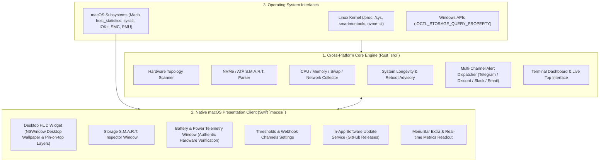

### Why a Hybrid Architecture?

| Component | Language | Rationale |
| :--- | :--- | :--- |
| **Telemetry Core** | **Rust 1.80+** | Zero-cost abstractions, memory safety, predictable microsecond latency, zero garbage collection pauses, and seamless compilation across Linux (`x86_64`, `aarch64`), macOS, and Windows. |
| **macOS Client** | **Swift 6 & SwiftUI** | First-party integration with Apple Human Interface Guidelines (HIG), native Cocoa `NSWindow` layering (Desktop wallpaper level vs Floating window level), `MenuBarExtra`, and direct IOKit / PMU power integration without bridge overhead. |

---

## 2. Cross-Platform Engine (Linux & Windows Support)

While the desktop floating widget is tailored for macOS, the **Rust telemetry engine (`src/`)** is 100% cross-platform and operates standalone in headless environments, cloud instances, and Linux servers:

### Linux Implementation
* **Memory & Swap**: Reads `/proc/meminfo` and `/proc/vmstat` to compute active memory, cache pages, dirty buffers, and swap thrashing.
* **Process Tracking**: Reads `/proc/[pid]/stat` and `/proc/[pid]/status` for low-overhead per-process CPU and RSS footprint without spawning external shell utilities.
* **Storage S.M.A.R.T.**: Communicates via direct Linux `ioctl` calls or queries standard kernel `sysfs` NVMe interfaces (`/sys/class/nvme/`).
* **Power & Battery**: Discovers battery controllers via `/sys/class/power_supply/BAT*`.
* **Headless Monitoring**: Runs as a background systemd daemon (`osprey daemon`), continuously monitoring thresholds and dispatching alerts to Telegram, Discord, and Slack webhooks.

### Windows Implementation
* Implements `IOCTL_STORAGE_QUERY_PROPERTY` and `SMART_RCV_DRIVE_DATA` via `windows-sys` crate for NVMe log page 0x02 decoding.

---

## 3. Native macOS Presentation Architecture

The macOS application located in `macos/` utilizes native macOS frameworks:

1. **Window Hierarchy & Leveling**:
   * **Desktop Wallpaper Mode**: The widget window (`DesktopWindow`) resides at `CGWindowLevelForKey(.desktopIconWindow) + 1`. It rests permanently on the desktop wallpaper behind all application windows without capturing focus.
   * **Pin on Top Mode**: When toggled, the widget level is promoted to `.floating`.
   * **Inspector Elevation**: Inspector windows (`SMARTInspectorView`, `BatteryInspectorView`, `AlertSettingsView`, `UpdateView`) observe `NSWindow.didBecomeKeyNotification` to dynamically match or exceed the widget level, guaranteeing they never open behind the floating widget.

2. **Hardware Mount Observers**:
   * Listens for `NSWorkspace.didMountNotification` and `NSWorkspace.didUnmountNotification`.
   * When an external USB-C or Thunderbolt NVMe drive is connected, Osprey instantly rescans drive topology without requiring manual refresh.

3. **In-App Auto-Update Pipeline**:
   * `UpdateChecker` queries the GitHub Releases API (`api.github.com/repos/kraloveckey/osprey/releases/latest`).
   * Evaluates semantic versions against `CoreInfo.version`.
   * Displays release notes with options to install directly or visit GitHub.

---

## 4. Visual Interface Gallery

### 1. Multi-Section Desktop Floating HUD
Real-time vitals, CPU core loads, memory breakdown with Swap tracking, SMART status, battery condition, network rates, and top 5 processes:

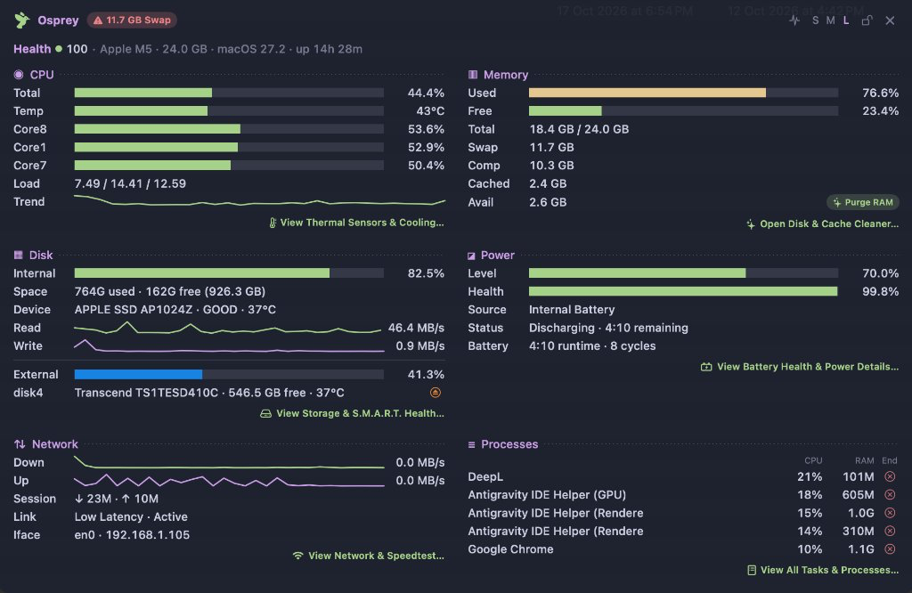

### 2. Storage S.M.A.R.T. Inspector Window
Deep NVMe & ATA health diagnostics, raw hexadecimal registers, APFS container mapping, and controller feature flags:

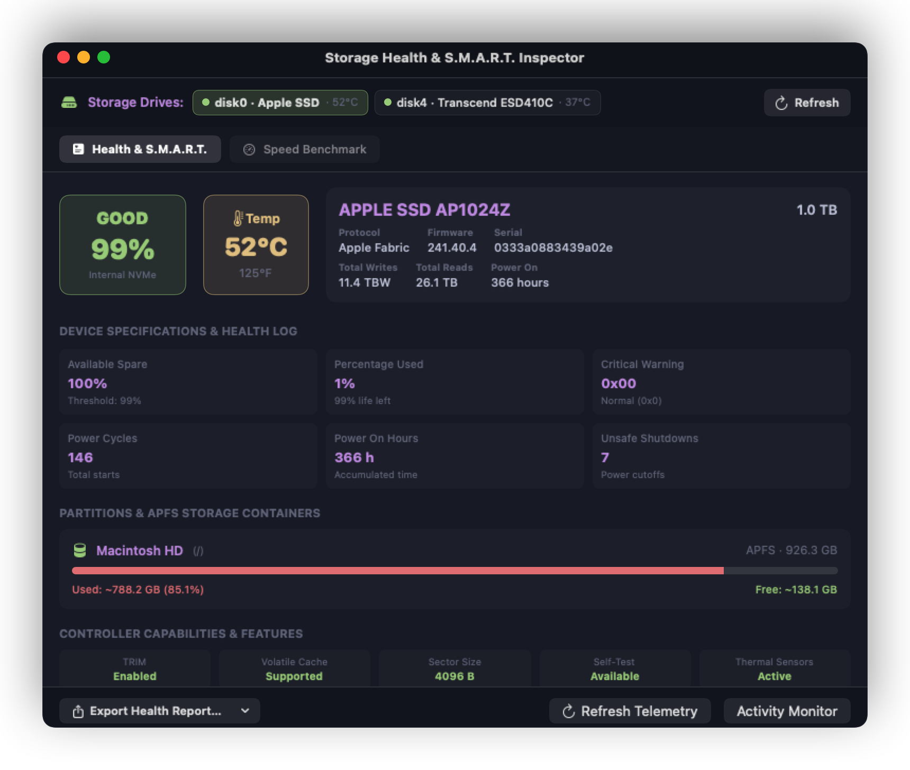

### 3. Battery & Real-Time Power Flow Inspector
Net instant power draw in Watts, pack voltage (mV), amperage load (mA), lifetime cycle count, health degradation, OEM adapter & cable authentication, Low Power Mode state, and text/JSON diagnostic report export:

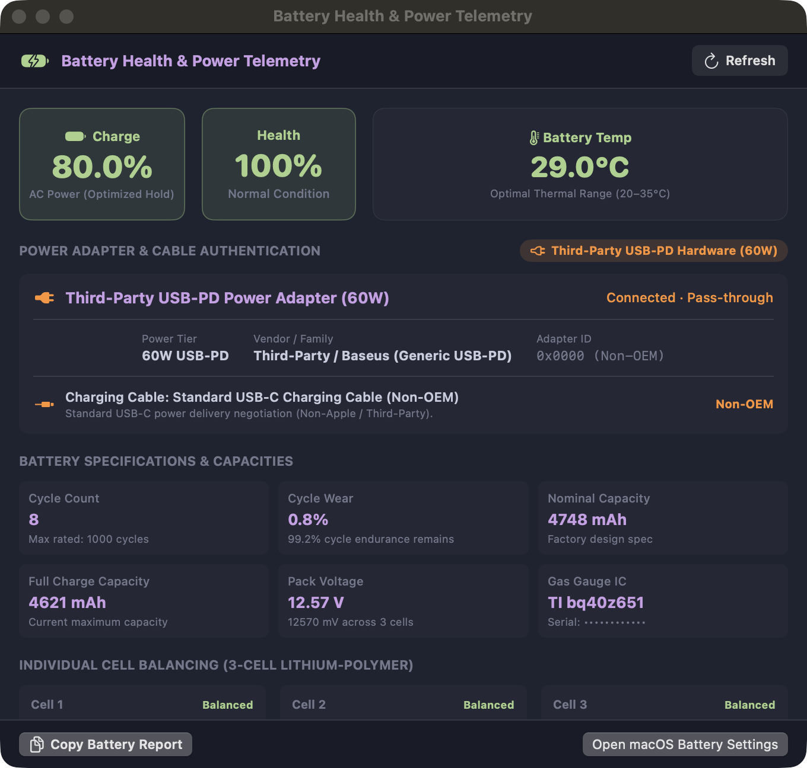

### 4. Hardware Thermal Sensors & Cooling Architecture
Per-core silicon junction thermistors, Left/Right Turbofans tachometers (RPM and % load), and macOS Dynamic Thermal Policy:

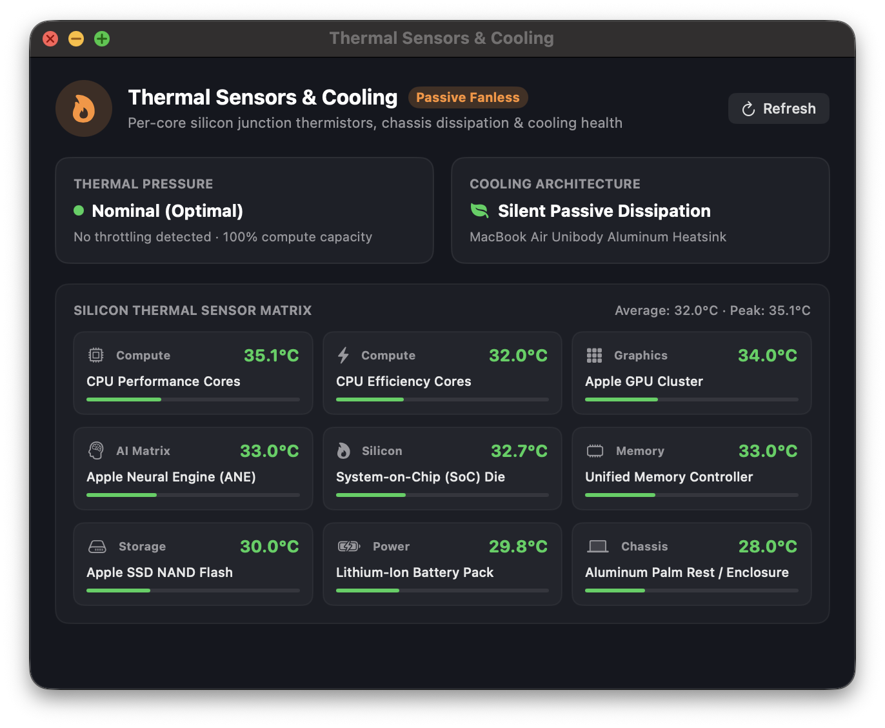

### 5. Network Throughput & Active Sockets Inspector
Wi-Fi telemetry, real-time download/upload benchmarks, and live process socket monitor with search, filters (All, Established, Listening), and 1-click process termination:

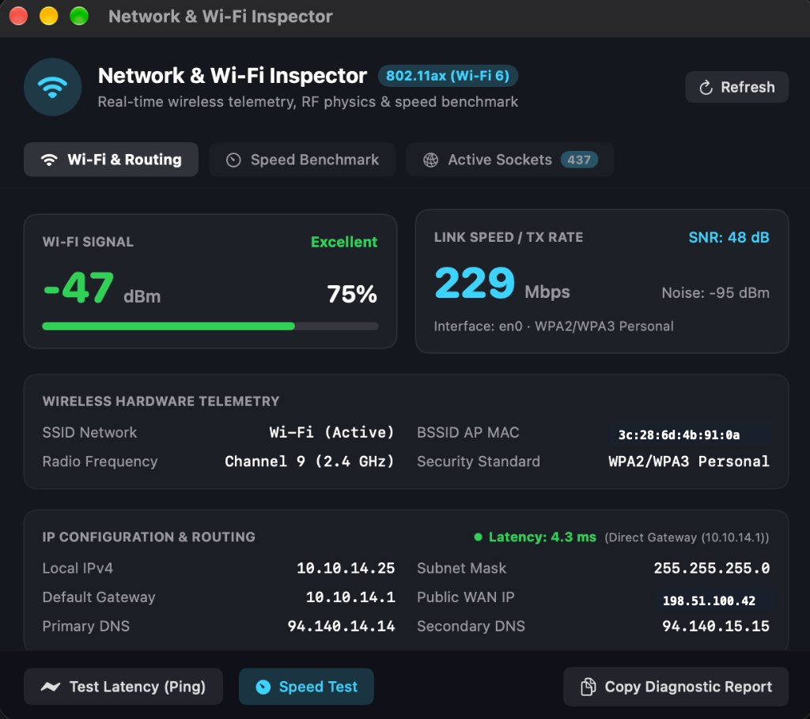

### 6. Process Inspector & Task Manager
Live per-app CPU load, RSS memory footprint, thread counts, quick search filtering, and 1-click process termination:

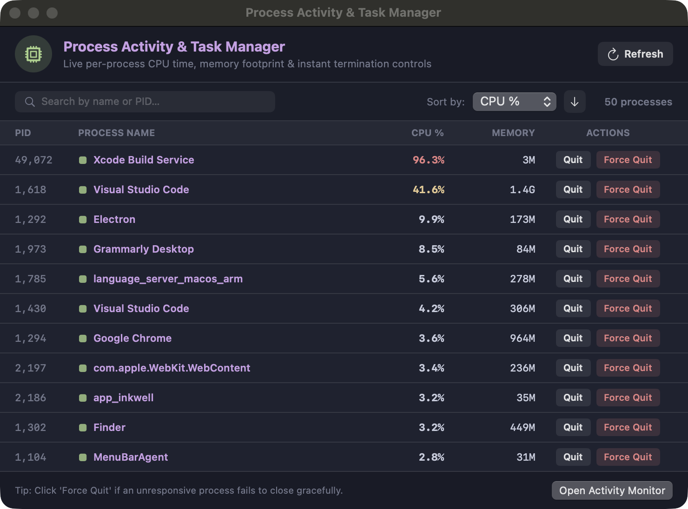

### 7. Storage Junk Cleaner & Maintenance
Fast reclamation of Xcode build caches, simulator runtimes, system log files, user caches, downloads, and trash:

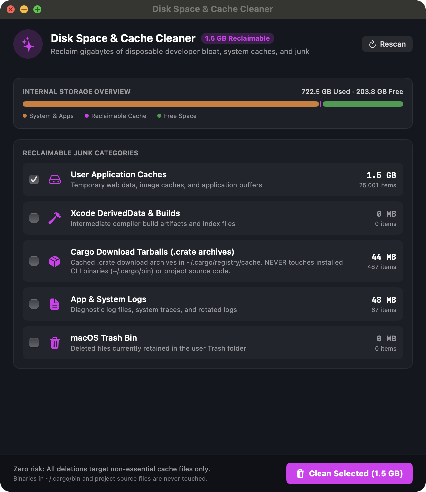

### 8. Storage Speed Benchmark
Sequential read/write throughput and random 4K IOPS storage performance benchmarking:

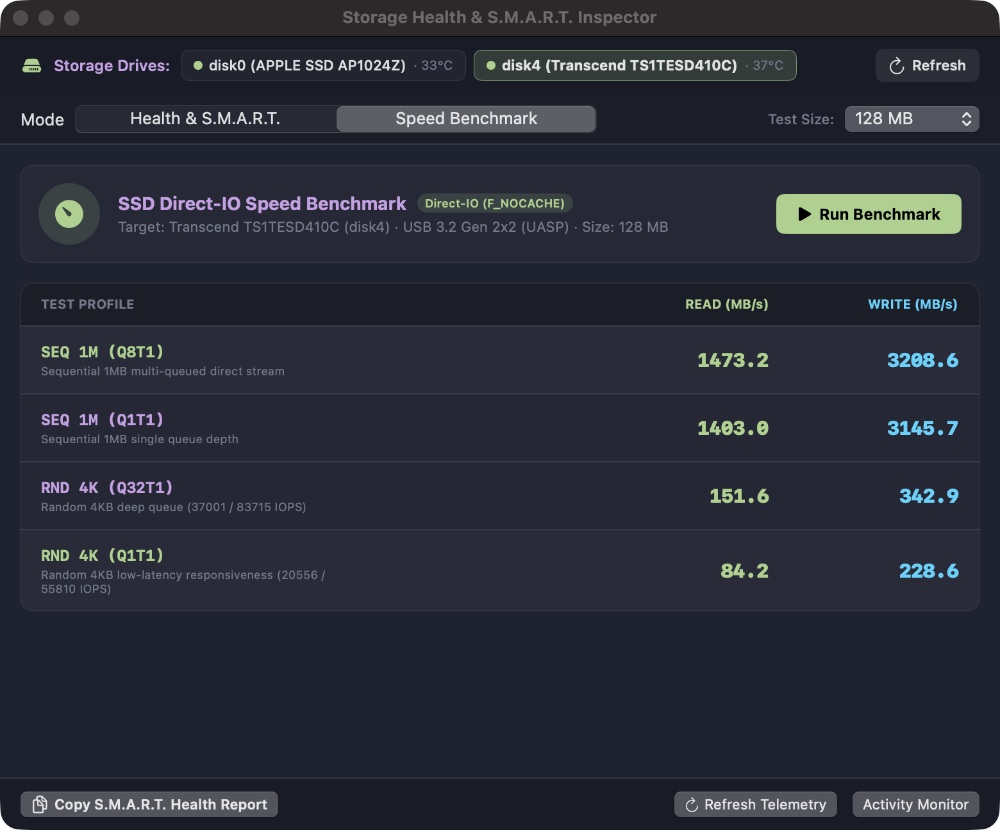

### 9. Alert Channels & Thresholds Configuration
Real-time auto-saving preferences, thermal threshold picker, SSD swap wear warning, low battery trigger, and webhook channels (Telegram, Discord, Slack, Email):

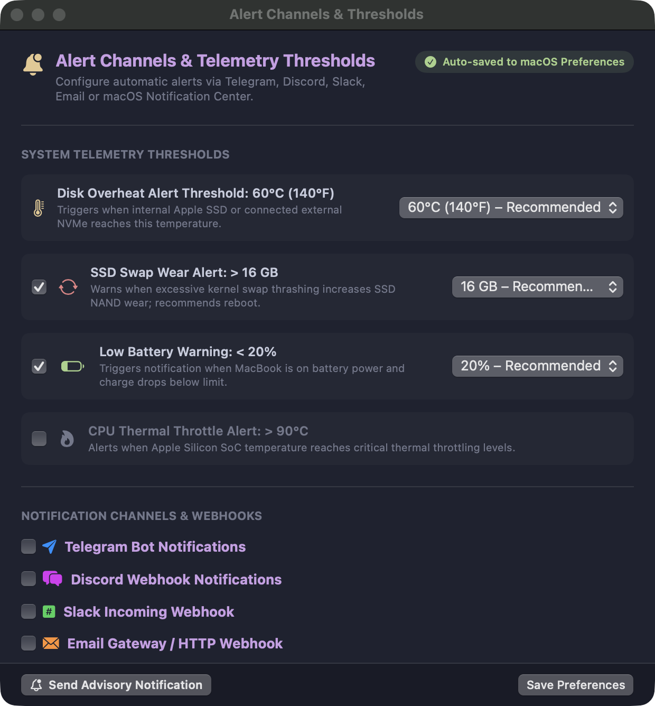

### 10. Menu Bar Extra & Reboot Advisory
Compact system menu featuring live metrics, reboot advisory prompt, one-click refresh, and inspector shortcuts:

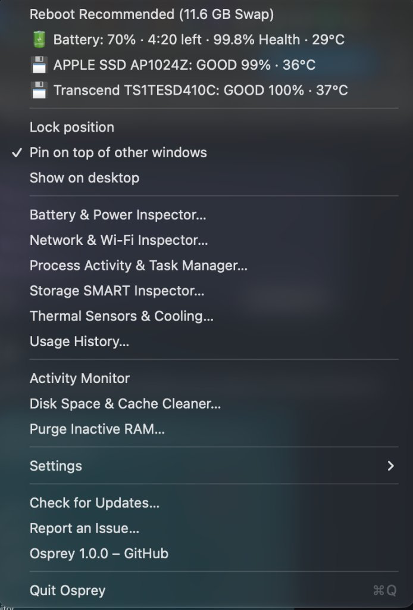

### 11. In-App Software Update Service
Zero-dependency GitHub release version checking with semantic comparison, release notes rendering, and direct installation:

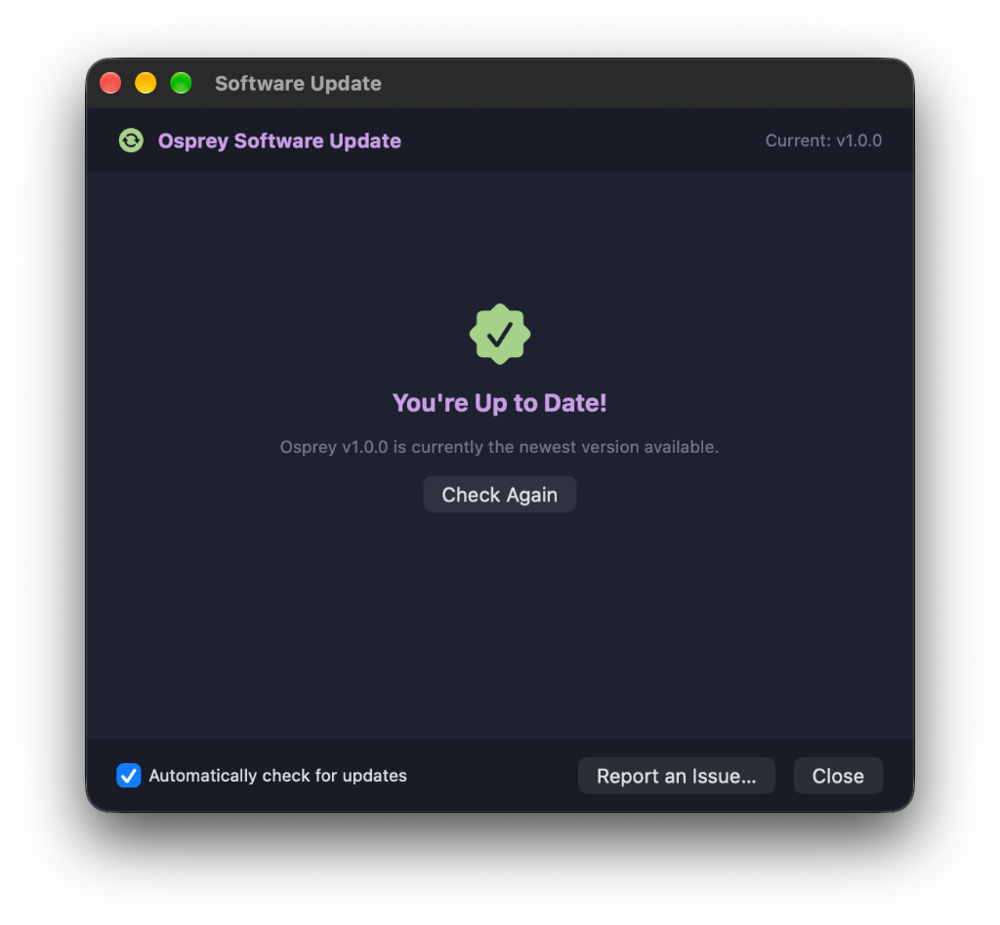
